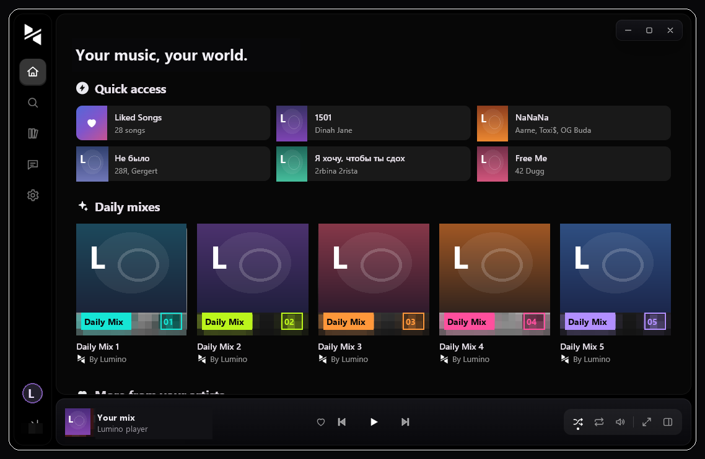
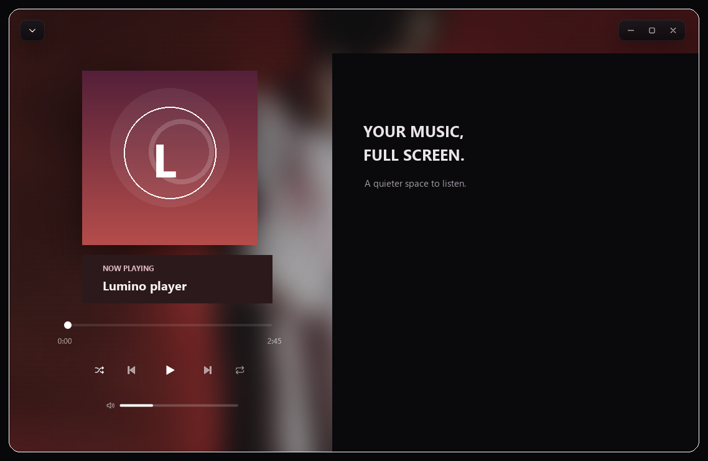
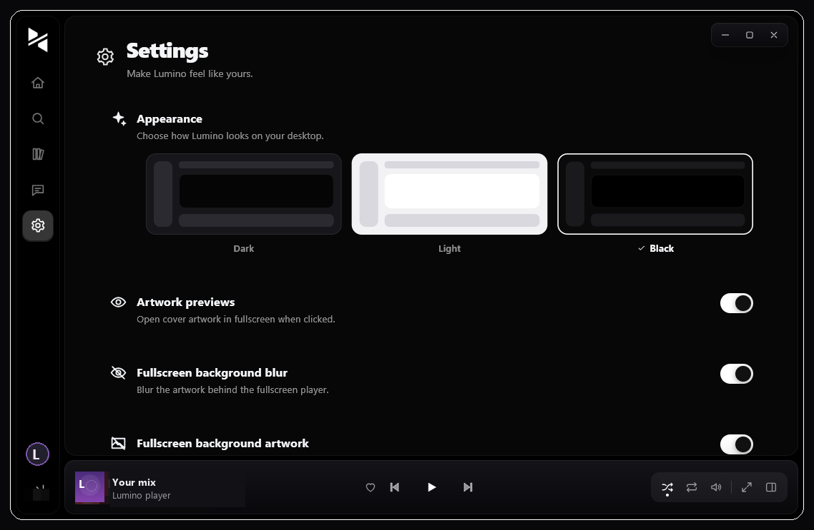

<div align="center">
  
  <h1>Lumino</h1>
  <p><strong>Your music. Your space.</strong><br>A desktop music player built with Flutter.</p>
  <p>
    <a href="https://github.com/theLuni/lumino/releases/latest"></a>
    
    
  </p>
</div>

<br>

## About

Lumino is a music player focused on a calm, immersive listening experience. Browse your music, build a library, and let the fullscreen player put the controls and artwork front and center.

<div align="center">
  
</div>

## Take a closer look

<table>
  <tr>
    <td width="50%" align="center">
      <strong>Fullscreen listening</strong><br><br>
      
    </td>
    <td width="50%" align="center">
      <strong>Make it yours</strong><br><br>
      
    </td>
  </tr>
</table>

## Features

- **A focused player** — playback controls, queue, shuffle, repeat, and a fullscreen listening view.
- **Your music in one place** — home, search, liked songs, playlists, and artist pages.
- **Personal touches** — dark, light, and black themes, plus configurable fullscreen artwork and blur.
- **Share and discover** — chat, share tracks, and explore recommendations.
- **Keep Lumino current** — check GitHub releases on sign-in or manually from Settings on Windows.

## Download

Get the latest Windows installer from **[GitHub Releases](https://github.com/theLuni/lumino/releases/latest)**.

## Run from source

You’ll need Flutter 3.27 or newer and the Windows desktop development tools configured for Flutter.

```powershell
git clone https://github.com/theLuni/lumino-app.git
cd lumino-app
flutter pub get
flutter run -d windows
```

To build a Windows release bundle:

```powershell
flutter build windows --release
```

On Windows, run [`build_release.bat`](build_release.bat) to set the app version, build Debug and Release, create the Inno Setup installer, and generate a `version.txt` report in `release_output`.

## Built with

[Flutter](https://flutter.dev/) · [Dart](https://dart.dev/) · [media_kit](https://pub.dev/packages/media_kit)
